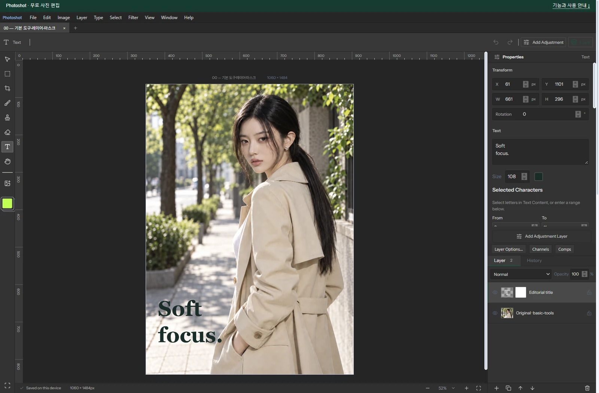

# Photoshot

**A free browser photo editor, and the engineering record of connecting existing technology with AI.**

[Try Photoshot](https://slohero.com/photoshot/editor/) · [Read the engineering notes](docs/devlog/README.md) · [Release v0.16.2](https://github.com/Abraham721/photoshot/releases/tag/v0.16.2)



## Engineering updates

Parts 1–12 are now concise English engineering notes: implementation boundaries, selected code, revision compatibility and validation scope. Each note links to its full website article. The website remains the complete development journal; Naver carries the development narrative in accessible Korean, with less code detail.

These editorial updates extend the engineering notes. Editor implementation remains the public v0.16.0 snapshot. Original Photoshot code is public source without an open-source license grant; see [COPYRIGHT.md](COPYRIGHT.md) and [third-party notices](THIRD_PARTY_NOTICES.md).

## Engineering notes: Parts 1–12

| Part | Technical focus |
|---|---|
| 01 | [Layer state, reversible masks, and a shared compositor](docs/devlog/01-basic-tools.md) |
| 02 | [Brightness/contrast: ordered response sampling and LUT compilation](docs/devlog/02-brightness-contrast.md) |
| 03 | [Levels: transfer function, inverse handle mapping, and alpha-weighted histograms](docs/devlog/03-levels-histogram.md) |
| 04 | [Curves: revisioned interpolation and channel-table order](docs/devlog/04-curves.md) |
| 05 | [Exposure: EV scaling, conversion space, and saved revisions](docs/devlog/05-exposure.md) |
| 06 | [Vibrance: HSL gain versus sampled RGB response](docs/devlog/06-vibrance.md) |
| 07 | [Hue/saturation: circular distance, feathering, and revisioned response](docs/devlog/07-hue-saturation.md) |
| 08 | [Color balance: revision branches and sequential tonal responses](docs/devlog/08-color-balance.md) |
| 09 | [Black & white: six hue weights, neutral invariance, and tint](docs/devlog/09-black-white.md) |
| 10 | [Photo filter: compiled color matrix versus layer compositing](docs/devlog/10-photo-filter.md) |
| 11 | [Channel mixer: RGB weights, constants and monochrome](docs/devlog/11-channel-mixer.md) |
| 12 | [Color lookup: validated grids, interpolation and limited ICC conversion](docs/devlog/12-color-lookup.md) |

Historical source-release episode numbering differs from the current journal order. Source UI strings remain unchanged.

## Run locally

Use Node.js 24 (minimum 22.13.0) and npm.

```sh
git clone https://github.com/Abraham721/photoshot.git
cd photoshot
npm ci
npm run dev
```

Open the local URL printed by Vite, normally `http://127.0.0.1:5173`. The standalone editor needs no backend or API key.

```sh
npm test
npm run build
npm run preview
```

The build is written to `dist/`. Use the development or preview server rather than opening `index.html` directly.

## What this source snapshot includes

- Image import, crop, text, brush/eraser, layer transforms and non-destructive masks.
- Project save/reopen, undo/redo and PNG/JPG export.
- Sixteen adjustment types, including brightness/contrast, levels, curves, exposure, vibrance, hue/saturation, color balance, black-and-white, photo filters and channel mixing.
- Layer opacity, clipping and 27 blend modes; CUBE/3DL/LOOK/CSP and limited ICC lookup support.
- Tests for masks, alpha, compositing, saved-project compatibility, adjustments, LUT/ICC parsing and transformations.

## Scope and limitations

This public snapshot is separate from the larger production application. It supports RGB 8-bit documents, a canvas dimension of up to 4096 pixels, up to 50 layers and image inputs up to 25 MB per file. PSD, RAW, CMYK, Camera Raw, AI layer separation and the production backend are outside this snapshot.

Edits are processed in the browser. Automatic recovery uses IndexedDB; keep exported `.layerstudio` project files because browser data can be cleared. The standalone snapshot uses its own `photoshot-adjustments` storage name. Fonts, browser behavior and blend modes can affect rendered results.

Photoshot is an independent project, not an Adobe product. A free editor is not a free distribution of Adobe Photoshop, and example comparisons do not establish full feature or pixel equivalence.

## Project layout

```text
src/                 Editor UI, document model and rendering/adjustment code
src/vendor/lcms/     Bundled ICC engine and its original license notices
tests/               Rendering, adjustment and compatibility checks
docs/devlog/         English engineering notes 1–12 and local images
docs/examples/       Small LUT examples
```

## Credits and rights

Created by [SLOHERO](https://slohero.com/). React, early PixiJS usage, later Canvas composition and third-party color components are described with their distinct roles in the articles. Referenced implementations are not presented as copied dependencies unless supported by the development record.

The demo portraits are AI-generated; editor screenshots and outputs are actual Photoshot results. Third-party libraries keep their own licenses. For use of original Photoshot code beyond rights granted by applicable law and GitHub's terms, contact the creator. Report reproducible issues without including private photos or credentials.
