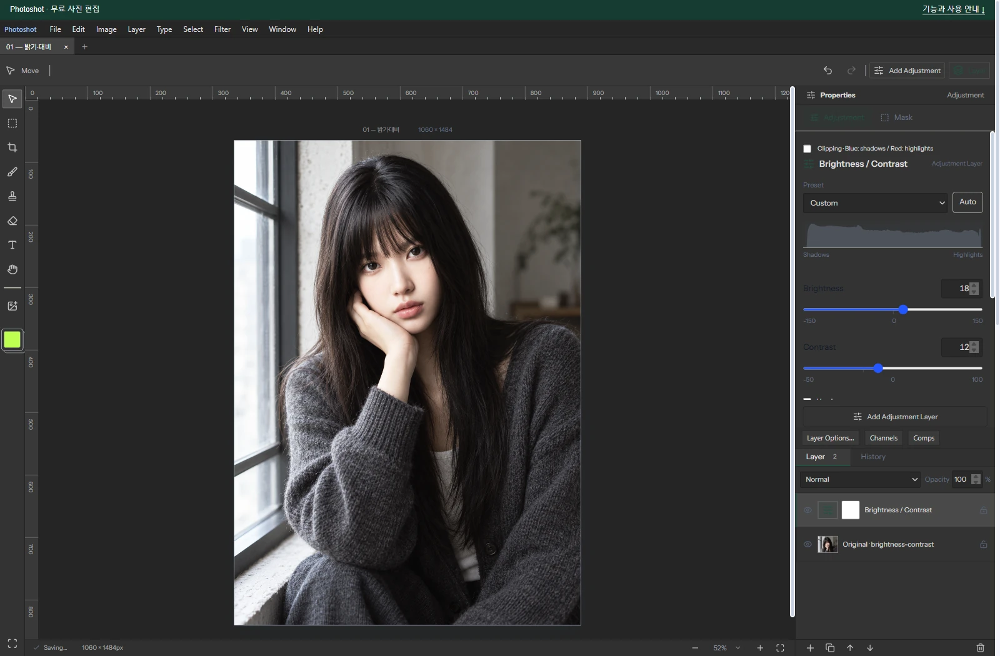

# Building a Free Photoshop Alternative, Part 2: Connecting Existing Contrast Code with AI

[All ten parts](README.md) · [Repository](../../README.md)

English edition · October 18, 2026 · Source excerpts pinned to their original revisions.

Brightness and contrast code was already available on GitHub. The remaining work was to understand it, connect it to adjustment layers and saved settings, and revise the result. Reading Konva and writing Photoshot’s calculation with AI shows the gap between an existing implementation and a usable editor.



*Actual Photoshot workspace. The example portrait is AI-generated; the editing interface and output are from Photoshot.*

## 1. Contrast was already a solved building block

A public contrast filter showed that one part of photo editing already had a working implementation. A function alone does not provide document storage, masks or previews. Our work with AI centered on moving that calculation from an isolated example into an editor.

The September 18, 2026 development record shows an actual lookup of konvajs/konva’s src/filters/Contrast.ts. Its pixel loop normalizes RGB and changes contrast around a midpoint. It provided a concrete implementation to inspect.

The evidence shows source consultation and a separately written implementation, not installation or verbatim copying of Konva’s filter into Photoshot.

## 2. Our first Photoshot calculation

The earlier formula remains in v0.16.0 for compatibility. It applies brightness first, then adjusts contrast around 0.5. Although Konva helped illustrate midpoint-based processing, these brightness and contrast expressions belong to Photoshot’s implementation.

Reading a reference did not provide a complete adjustment layer. Stored values, masks, opacity and rendering still needed integration.

AI helped with reading the existing implementation and writing code for the inputs and outputs of our engine. Selecting a useful principle and connecting it to the shared adjustment path mattered more than attaching the external filter unchanged.

[src/adjustments.ts · v0.16.0 · lines 506–510](https://github.com/Abraham721/photoshot/blob/v0.16.0/src/adjustments.ts#L506-L510)

```ts
if (t === 'brightness' && a.revision !== 2) {
  x = v.brightness < 0 ? x * (1 + v.brightness / 100) : x + ((1 - x) * v.brightness) / 100;
  const contrast = v.contrast < 0 ? 1 + v.contrast / 100 : 1 / (1 - v.contrast / 101);
  x = (x - 0.5) * contrast + 0.5;
}
```

## 3. Comparison changed the implementation

On September 25 we compared a test chart with Photoshop 27.3.1. At brightness +30 and contrast +20, the intermediate implementation in that comparison had a mean channel-value difference of about 11.505 and a maximum of 25. This was not a direct measurement of the original September 18 code.

The revised normal mode reads measured response data through sampleResponse. The two lines below apply brightness and then contrast. Reference reading had become an application-specific correction based on observed output.

[src/adjustments.ts · v0.16.0 · lines 517–518](https://github.com/Abraham721/photoshot/blob/v0.16.0/src/adjustments.ts#L517-L518)

```ts
x = sampleResponse(toneResponse.brightness, v.brightness, -150, x);
x = sampleResponse(toneResponse.contrast, v.contrast, -50, x);
```

## 4. Compile once, reuse a 256-entry table

Each channel has 256 possible byte inputs. Instead of repeating the full calculation for every pixel, compileAdjustment builds a lookup table and reuses it. The excerpt below is Photoshot’s table-construction code.

Connecting brightness to this shared path also gave levels, curves and exposure a common home. The integration work was as important as the individual formula.

[src/adjustments.ts · v0.16.0 · lines 503–505](https://github.com/Abraham721/photoshot/blob/v0.16.0/src/adjustments.ts#L503-L505)

```ts
const tables = ['r', 'g', 'b'].map((channel) =>
  Float64Array.from({ length: 256 }, (_, i) => {
    let x = i / 255;
```

## 5. The photo example and the numerical test

The portrait example uses brightness 18 and contrast 12, not the +30/+20 chart settings. The source portrait is AI-generated; the screenshot and adjusted output come from the actual editor.

For the recorded +30/+20 chart, the revision reduced mean difference to about 0.241 and maximum difference to 1. Reversing the order to contrast then brightness produced about 1.150 and 4. Operation order was part of the implementation, too.

## 6. From a GitHub reference to verified application code

Konva’s Contrast.ts was the external implementation we consulted. Photoshot’s adjustments.ts and response-data wiring were written and revised with AI. The development work combined finding useful public implementations with integrating and testing our own code.

The barrier AI helped lower was the work between reference code and product code, not the absence of a contrast formula. Public source supplied a starting point; integration, revisions and output comparisons turned it into an editing feature.

These numbers describe a specific historical chart and settings, not universal equivalence with Photoshop. Next comes levels and its histogram, connected to the same adjustment path.

## Image comparison


*Before: AI-generated example portrait.*


*After: actual Photoshot output. Settings and verification limits are described in the article above.*

## Implementation and references

- [Konva · Contrast.ts (reference)](https://github.com/konvajs/konva/blob/master/src/filters/Contrast.ts)
- [Photoshot · adjustments.ts](https://github.com/Abraham721/photoshot/blob/v0.16.0/src/adjustments.ts)

---

[← Part 1](01-basic-tools.md)
[Part 3 →](03-levels-histogram.md)
