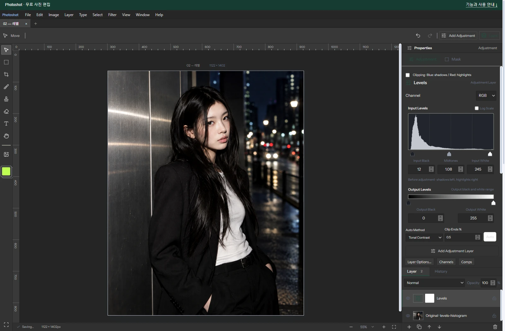
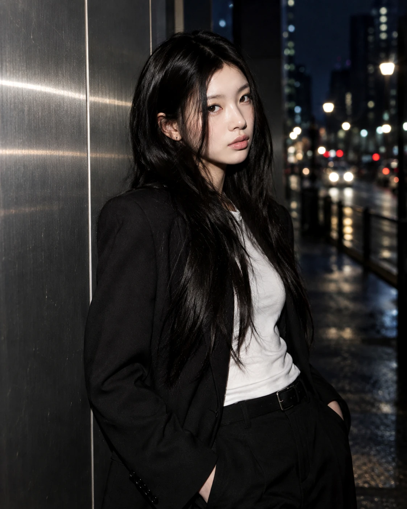

# Building a Free Photoshop Alternative, Part 3: Assembling Familiar Levels Math into a Tool

[All ten parts](README.md) · [Repository](../../README.md)

English edition · October 18, 2026 · Source excerpts pinned to their original revisions.

Levels mathematics and histograms predate AI. The task was to implement that knowledge across calculation, controls and analysis, then connect it to an existing engine. Photoshot’s Levels tool combines behavior checked in GIMP’s documentation with three application files written with AI.



*Actual Photoshot workspace. The example portrait is AI-generated; the editing interface and output are from Photoshot.*

## 1. Known behavior, components to connect

This is an implementation of an established feature on existing code, not an import of GIMP’s source. Reusing the lookup-table path and adjustment layers meant that adding Levels did not require rebuilding the document or compositing engine.

GIMP’s Levels documentation helped distinguish input endpoints, output range, gamma and individual channels. It was a behavioral reference; the record does not establish a port of GIMP’s C implementation.

We added the calculation to adjustments.ts, handle coordinates to levels-controls.ts and histogram analysis to tone-analysis.ts. Those three Photoshot files are the GitHub trail for this entry.

## 2. Put levels into the existing LUT path

Read the expression as input normalization, inverse gamma, then output-range mapping. The loop applies the shared rgb settings and then the individual channel settings.

This calculation lives inside the existing 256-entry table builder. The new function could therefore use the adjustment layer’s established masking, opacity and persistence flow.

Code written with AI connected a familiar formula to the calculation engine and kept it in step with the controls. Reusing the foundation narrowed the amount of new implementation required for the feature.

[src/adjustments.ts · v0.16.0 · lines 521–528](https://github.com/Abraham721/photoshot/blob/v0.16.0/src/adjustments.ts#L521-L528)

```ts
if (t === 'levels')
  for (const c of ['rgb', channel])
    x =
      (v[c + 'OutBlack'] +
        (v[c + 'OutWhite'] - v[c + 'OutBlack']) *
          clamp((x * 255 - v[c + 'Black']) / (v[c + 'White'] - v[c + 'Black'])) **
            (1 / v[c + 'Gamma'])) /
      255;
```

## 3. The middle handle must match the math

The middle handle cannot simply sit at the geometric center. It represents the input that becomes 50% after gamma correction. gammaPosition maps gamma to a position; gammaAtPosition uses logarithms for the inverse mapping.

Keeping the pair together allows typed values and dragged handles to describe the same adjustment. The integration required both directions, not merely a formula that changed pixels.

[src/levels-controls.ts · v0.16.0 · lines 2–13](https://github.com/Abraham721/photoshot/blob/v0.16.0/src/levels-controls.ts#L2-L13)

```ts
// The middle handle marks the input that becomes 50% after inverse gamma.
export function gammaPosition(black: number, white: number, gamma: number) {
  return black + (white - black) * Math.pow(0.5, clamp(gamma, 0.1, 10));
}
export function gammaAtPosition(black: number, white: number, position: number) {
  const t = clamp(
    (position - black) / Math.max(1, white - black),
    Math.pow(0.5, 10),
    Math.pow(0.5, 0.1),
  );
  return Math.round(clamp(Math.log(t) / Math.log(0.5), 0.1, 10) * 100) / 100;
}
```

## 4. The histogram needs an alpha rule

A histogram is not decoration. Counting transparent pixels as black would misrepresent the image. tone-analysis.ts uses alpha as a weight, skips fully transparent pixels, and accumulates luminance and RGB distributions separately.

This analysis code was written with AI and connected to the document being adjusted. That connection turns a pixel operation into an editing tool a person can interpret.

[src/tone-analysis.ts · v0.16.0 · lines 22–28](https://github.com/Abraham721/photoshot/blob/v0.16.0/src/tone-analysis.ts#L22-L28)

```ts
const weight = data[i + 3] / 255;
if (!weight) continue;
bins[Math.round(0.2126 * data[i] + 0.7152 * data[i + 1] + 0.0722 * data[i + 2])] += weight;
channelBins.r[data[i]] += weight;
channelBins.g[data[i + 1]] += weight;
channelBins.b[data[i + 2]] += weight;
count += weight;
```

## 5. The editor and comparison record

The portrait uses RGB input 12 / 1.08 / 245 and output 0 / 255. The source portrait is AI-generated; the editor view and output are real.

The historical Photoshop chart used different input settings: 18 / 1.12 / 235, with output 0 / 255. Its mean channel difference was about 0.229, maximum 1. Handle-to-value consistency was checked separately.

## 6. Three files, one coherent tool

Levels combines behavior learned from documentation with calculation, interaction and analysis code integrated into Photoshot. The public files make those responsibilities inspectable.

AI did not originate the mathematics of Levels. Its practical role was to help connect calculations, handles and histograms to the same document. Established knowledge and accumulated code became a usable tool through that integration.

The value of AI-assisted code was the correctness of those connections. Part 4 follows the LUT idea examined in glfx.js and the interpolation code written separately for Photoshot.

## Image comparison


*Before: AI-generated example portrait.*



*After: actual Photoshot output. Settings and verification limits are described in the article above.*

## Implementation and references

- [GIMP · Levels documentation](https://docs.gimp.org/3.0/en/gimp-tool-levels.html)
- [Photoshot · levels-histogram.mjs](https://github.com/Abraham721/photoshot/blob/v0.16.0/tests/levels-histogram.mjs)

---

[← Part 2](02-brightness-contrast.md)
[Part 4 →](04-curves.md)
