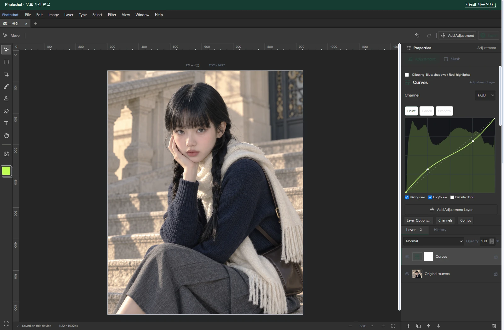

# Building a Free Photoshop Alternative, Part 4: Connecting a GitHub Curves Idea with AI

[All ten parts](README.md) · [Repository](../../README.md)

English edition · October 18, 2026 · Source excerpts pinned to their original revisions.

Implementations that turn curves into pixel values were already on GitHub. We read glfx.js’s lookup-table structure, then worked with AI to connect interpolation, controls and saved-version rules in Photoshot. Existing ideas became a feature through adaptation to the editor.



*Actual Photoshot workspace. The example portrait is AI-generated; the editing interface and output are from Photoshot.*

## 1. A working starting point was public

Readable implementations meant we did not need to invent every part from scratch. But the external curves filter and our editor used different rendering and document structures. The work with AI was to understand the design and implement the relevant parts for Photoshot.

In evanw/glfx.js, src/filters/adjust/curves.js builds interpolated values from control points and prepares 256 entries for channel lookup. The original development record explicitly notes examining this LUT idea.

Photoshot did not adopt the whole WebGL filter. We wrote separate interpolation functions and connected them to compileAdjustment. The borrowed architectural idea and our choice of interpolation are distinct.

## 2. The first implementation used shape-preserving Hermite

Our first curveTable used shape-preserving Hermite interpolation. This excerpt chooses tangents at control points; when adjacent slopes change sign, it uses zero to limit unwanted overshoot around sharp edits.

This was not a copied glfx.js interpolator. We adopted the precomputation idea while writing the math and TypeScript implementation separately.

The interpolation code written with AI used the existing lookup-table engine. Adding Curves therefore did not require new mask or layer-compositing machinery. The design learned from external source connected to our shared application code.

[src/adjustments.ts · v0.16.0 · lines 380–388](https://github.com/Abraham721/photoshot/blob/v0.16.0/src/adjustments.ts#L380-L388)

```ts
const m = points.map((_, i) =>
  i === 0
    ? d[0]
    : i === n - 1
      ? d[n - 2]
      : d[i - 1] * d[i] <= 0
        ? 0
        : 2 / (1 / d[i - 1] + 1 / d[i]),
);
```

## 3. Comparison led to a natural cubic spline

Identical control points can yield different intermediate tones when interpolation differs. The upgraded path added naturalCurveTable. The excerpt is the forward calculation used to solve spline curvature.

Saying only that AI built a curves feature hides this development step: start from an inspected idea, write our own function, compare output, then revise the interpolation choice.

[src/adjustments.ts · v0.16.0 · lines 414–424](https://github.com/Abraham721/photoshot/blob/v0.16.0/src/adjustments.ts#L414-L424)

```ts
for (let i = 1; i < n - 1; i++) {
  const span = points[i + 1].x - points[i - 1].x,
    sig = (points[i].x - points[i - 1].x) / span,
    p = sig * y2[i - 1] + 2;
  y2[i] = (sig - 1) / p;
  const slope =
    (points[i + 1].y - points[i].y) / (points[i + 1].x - points[i].x) -
    (points[i].y - points[i - 1].y) / (points[i].x - points[i - 1].x);
  u[i] = ((6 * slope) / span - sig * u[i - 1]) / p;
}
for (let i = n - 2; i >= 0; i--) y2[i] = y2[i] * y2[i + 1] + u[i];
```

## 4. Use the same curve version in the UI and pixels

Applying new math to every saved file could change older work. Revision 2 selects the natural spline; older adjustments keep Hermite. The curve editor selects its displayed table using the same condition.

Pixel processing first reads the individual channel table, then the shared RGB table, interpolating between adjacent entries for fractional positions. This connects the LUT idea to Photoshot’s channel order and compatibility rules.

[src/curves-editor.tsx · v0.16.0 · lines 43–43](https://github.com/Abraham721/photoshot/blob/v0.16.0/src/curves-editor.tsx#L43-L43)

```tsx
const table = (value.revision === 2 ? naturalCurveTable : curveTable)(points),
```

[src/adjustments.ts · v0.16.0 · lines 529–535](https://github.com/Abraham721/photoshot/blob/v0.16.0/src/adjustments.ts#L529-L535)

```ts
if (t === 'curves') {
  x = ct![channel as Channel][i];
  const f = clamp(x) * 255,
    lo = Math.floor(f),
    hi = Math.min(255, lo + 1);
  x = ct!.rgb[lo] + (ct!.rgb[hi] - ct!.rgb[lo]) * (f - lo);
}
```

## 5. Testing the interpolation choice

The portrait uses RGB points (0,0), (64,80), (192,176), (255,255). Its source is an AI-generated example; the editor and output are actual Photoshot results.

The historical comparison chart instead used (0,0), (64,48), (192,208), (255,255). That recorded test reached mean and maximum differences of zero after revision. It establishes agreement for that input, not every curve or photograph.

## 6. Adapt the idea to the application’s rules

glfx.js was a concrete starting point for understanding LUT-based curves. Photoshot’s Hermite and natural-spline functions, editor integration and compatibility handling were written and revised separately with AI.

The central contribution was the connection between a public curves idea and an existing engine. Comparing outputs, revising interpolation and preserving compatibility were part of the same work. Combining code meant adapting it to product rules, not a single copy-and-paste operation.

Public code helped us understand a design and connect it to our layer system. Part 5 continues with exposure calculations and version compatibility.

## Image comparison


*Before: AI-generated example portrait.*


*After: actual Photoshot output. Settings and verification limits are described in the article above.*

## Implementation and references

- [glfx.js · curves.js (reference)](https://github.com/evanw/glfx.js/blob/master/src/filters/adjust/curves.js)
- [Photoshot · adjustments.ts](https://github.com/Abraham721/photoshot/blob/v0.16.0/src/adjustments.ts)

---

[← Part 3](03-levels-histogram.md)
[Part 5 →](05-exposure.md)
