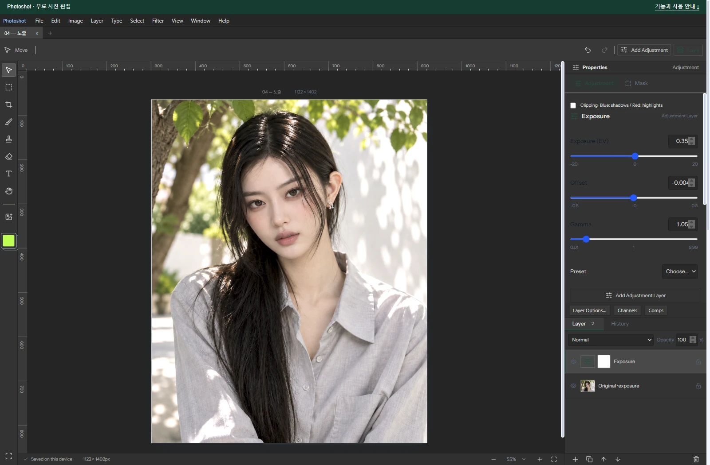

# Building a Free Photoshop Alternative, Part 5: Reusing the Foundation for Exposure

[All ten parts](README.md) · [Repository](../../README.md)

English edition · October 18, 2026 · Source excerpts pinned to their original revisions.

The adjustment layers and lookup tables built for earlier tools could also support Exposure. AI’s role was not to create a separate filter application each time. It helped connect known color conversions and EV calculations to the existing engine while keeping new behavior and older documents compatible.



*Actual Photoshot workspace. The example portrait is AI-generated; the editing interface and output are from Photoshot.*

## 1. Connected code becomes a foundation for the next tool

Once separate capabilities are assembled into a product, their shared code becomes reusable infrastructure. Exposure extends an engine built through earlier GitHub research and application code; it does not introduce another imported filter package.

Earlier entries consulted Konva and glfx.js. For exposure, the concrete reuse point is Photoshot’s compileAdjustment: exposure appears alongside brightness, levels and curves in the shared branch below.

We added the calculation to the existing layer, lookup-table and masking flow rather than building an independent editor for it. AI-assisted code extended the structure already in place.

[src/adjustments.ts · v0.16.0 · lines 493–493](https://github.com/Abraham721/photoshot/blob/v0.16.0/src/adjustments.ts#L493-L493)

```ts
if (['brightness', 'levels', 'curves', 'exposure', 'invert', 'posterize'].includes(t)) {
```

[src/adjustments.ts · v0.16.0 · lines 503–505](https://github.com/Abraham721/photoshot/blob/v0.16.0/src/adjustments.ts#L503-L505)

```ts
const tables = ['r', 'g', 'b'].map((channel) =>
  Float64Array.from({ length: 256 }, (_, i) => {
    let x = i / 255;
```

## 2. The earlier path used sRGB conversion

Exposure is not simply an EV number added to stored display-channel values. The earlier path used linear to decode sRGB and srgb to encode it again.

These are excerpts from Photoshot expressing standard color-conversion formulas in TypeScript. The record does not establish that these lines were copied from a specific repository. Writing code with AI does not mean inventing the underlying mathematics.

Reusing settings storage and compositing lets new implementation concentrate on exposure calculations and their connection. This cumulative reuse is one reason development with AI can be effective: the foundation can be extended instead of recreated for every feature.

[src/adjustments.ts · v0.16.0 · lines 482–483](https://github.com/Abraham721/photoshot/blob/v0.16.0/src/adjustments.ts#L482-L483)

```ts
const linear = (s: number) => (s <= 0.04045 ? s / 12.92 : ((s + 0.055) / 1.055) ** 2.4);
const srgb = (s: number) => (s <= 0.0031308 ? 12.92 * s : 1.055 * s ** (1 / 2.4) - 0.055);
```

## 3. Revising exposure, offset and gamma with AI

The key factor is 2 ** v.ev: +1 EV doubles the linear-domain value and −1 halves it, before offset and gamma processing. The conversion space and operation order affect the output.

After comparison, revision 2 uses the 2.2-power path. Older adjustments keep the linear/srgb path. The branch below preserves both implementations in the same function.

[src/adjustments.ts · v0.16.0 · lines 536–540](https://github.com/Abraham721/photoshot/blob/v0.16.0/src/adjustments.ts#L536-L540)

```ts
if (t === 'exposure')
  x =
    a.revision === 2
      ? clamp(x ** 2.2 * 2 ** v.ev + v.offset) ** (1 / (2.2 * v.gamma))
      : srgb(clamp(linear(x) * 2 ** v.ev + v.offset) ** (1 / v.gamma));
```

## 4. Better math must not silently change old work

Changing a formula is easier than preserving the meaning of saved work. Applying new math while loading an old adjustment could change an image without the user editing anything.

The revision branch is a compatibility rule, continuing the approach used for curves. The AI-assisted change included how existing data selects a calculation, not just a new function.

## 5. Exposure tests and the portrait result

The portrait example uses EV +0.35, offset −0.004 and gamma 1.05. Its source portrait is AI-generated; the screenshot and result are from Photoshot.

In the historical Photoshop chart comparison, +1 / 0 / 1 produced mean difference about 0.015 and maximum 2; −0.7 / 0.015 / 1.2 produced about 0.015 and maximum 1. These are two recorded test conditions, not a claim covering every HDR or color-management workflow.

## 6. Parts 1–5: find, connect and revise code

The first five entries share a method: use actual dependencies such as React and early PixiJS; inspect implementations such as Konva and glfx.js; connect them with AI-assisted document, layer, calculation and UI code; then revise against measured output.

Parts 1–5 show no sudden invention of image-editing technology. Existing libraries, public implementations and known calculations supplied foundations that we connected and extended with AI. Reusing that shared code as features accumulate provides a practical route to an alternative editor.

Exposure shows how that work becomes a foundation for another feature. The excerpts use public v0.16.0 code, with sources and test scope kept explicit so the reuse and new implementation remain traceable.

## Image comparison


*Before: AI-generated example portrait.*


*After: actual Photoshot output. Settings and verification limits are described in the article above.*

## Implementation and references

- [Photoshot · adjustments.ts](https://github.com/Abraham721/photoshot/blob/v0.16.0/src/adjustments.ts)
- [Photoshot · adjustment-render.mjs](https://github.com/Abraham721/photoshot/blob/v0.16.0/tests/adjustment-render.mjs)

---

[← Part 4](04-curves.md)
[Part 6 →](06-vibrance.md)
