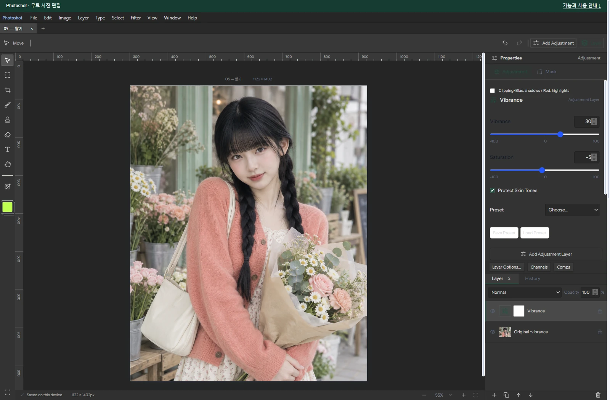

# Building a Free Photoshop Alternative, Part 6: From Existing Vibrance Code to Integration with AI

[All ten parts](README.md) · [Repository](../../README.md)

English edition · October 18, 2026 · Source excerpts pinned to their original revisions.

Code that adjusts saturation differently across colors was already on GitHub. The task was to understand the idea and make it work within an existing adjustment engine. After reading glfx.js, we worked with AI on a separate HSL calculation and connected measured responses to the same tool.



*Actual Photoshot workspace. The example portrait is AI-generated; the editing interface and output are from Photoshot.*

## 1. Color-processing code was already available

Public implementations moved the starting point forward by showing how inputs could produce different color responses. Our work with AI went beyond running that code unchanged: it connected an implementation suited to Photoshot’s color conversions and adjustment layers.

The September 18 development session records an actual read of glfx.js’s vibrance.js, not just a search result. Its shader uses the RGB maximum and average to make the response depend on the input color. It gave us a useful starting point for thinking about uneven color response.

Photoshot did not import that shader unchanged. The contemporary development notes describe a separate HSL calculation weighted by (1−S). The external reference supplied an example to study; the code we wrote with AI supplied Photoshot’s implementation.

## 2. Weighting the HSL response

Here is Photoshot’s own code, published on GitHub. The variable s is saturation on a 0–1 scale. Multiplying vibrance by (1−s) gives already saturated colors a smaller additional gain. The saturation slider supplies a separate multiplier afterward.

This explains the HSL path, not every path through the current public implementation. A revision 2 adjustment with protection enabled takes the measured-response branch described next.

We reused a demonstrated color-processing idea and our internal adjustment foundation, rather than an entire external filter. Connecting the AI-assisted calculation to that engine gave it the same settings storage and masks as other adjustments.

[src/adjustments.ts · v0.16.0 · lines 646–647](https://github.com/Abraham721/photoshot/blob/v0.16.0/src/adjustments.ts#L646-L647)

```ts
const gain = (v.vibrance / 100) * (1 - s) * (1 - 0.75 * skin);
fromHsl(h, clamp(s * (1 + gain) * (1 + v.saturation / 100)), l, out);
```

## 3. Connecting measured responses with AI

The later implementation uses responses measured by sending synthetic RGB charts through Photoshop. The source identifies a 17×17×17 RGB grid measured in Photoshop 27.3.1. These are not Adobe preset files or tables taken from glfx.js.

The integration written with AI applies the vibrance response first, then feeds its output into the saturation response. Colors and slider settings between samples are interpolated. Keeping the response data separate from the adjustment engine let us connect this work to the existing layer system.

[src/adjustments.ts · v0.16.0 · lines 634–642](https://github.com/Abraham721/photoshot/blob/v0.16.0/src/adjustments.ts#L634-L642)

```ts
} else if (a.revision === 2 && v.skin) {
  scratch[0] = r;
  scratch[1] = g;
  scratch[2] = b;
  applyVibranceResponse(scratch, v.vibrance, 0, out);
  scratch[0] = out[0];
  scratch[1] = out[1];
  scratch[2] = out[2];
  applyVibranceResponse(scratch, v.saturation, 1, out);
```

[src/vibrance-response.ts · v0.16.0 · lines 60–67](https://github.com/Abraham721/photoshot/blob/v0.16.0/src/vibrance-response.ts#L60-L67)

```ts
const p = Math.max(0, Math.min(20, (value + 100) / 10)),
  lo = Math.floor(p),
  hi = Math.min(20, lo + 1),
  f = p - lo,
  a = data[mode * 21 + lo],
  b = data[mode * 21 + hi];
table = new Float32Array(a.length);
for (let i = 0; i < a.length; i++) table[i] = a[i] + (b[i] - a[i]) * f;
```

## 4. What the protection option actually selects

The option’s name may suggest that the editor locates a face. This path receives RGB values and slider settings; it does not know whether a pixel belongs to skin, a wall, or clothing. Identical RGB inputs receive identical processing.

It is more accurate to describe the option as selecting a color-response method. Targeting one person still requires a layer mask. Interpolation between measured samples also means that this implementation is not a promise of identical Photoshop output for every photograph.

## 5. The photo example and the scope of the checks

The saved photo example uses Vibrance +30, Saturation −5, and protection on. It shows an AI-generated portrait edited in Photoshot, not a failure screenshot from the initial implementation day.

Vibrance did not become possible because AI invented a new color theory. Readable public implementations provided a starting point for connecting our calculations and measured data with AI. Existing technology becomes useful in an editor when it can be combined and revised where needed.

The public tests/vibrance.mjs checks neutral settings in both modes, alpha preservation, extreme values, and invalid input. We inspected those checks for this article; this is not a claim that we reran a full product test suite. Next, we move from overall color response to selecting a particular range such as blue.

## Image comparison


*Before: AI-generated example portrait.*


*After: actual Photoshot output. Settings and verification limits are described in the article above.*

## Implementation and references

- [glfx.js / vibrance.js — external implementation reference](https://github.com/evanw/glfx.js/blob/master/src/filters/adjust/vibrance.js)
- [Photoshot / vibrance tests](https://github.com/Abraham721/photoshot/blob/v0.16.0/tests/vibrance.mjs)

---

[← Part 5](05-exposure.md)
[Part 7 →](07-hue-saturation.md)
