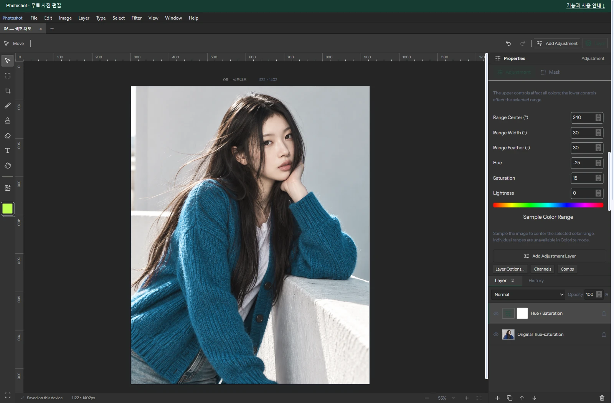
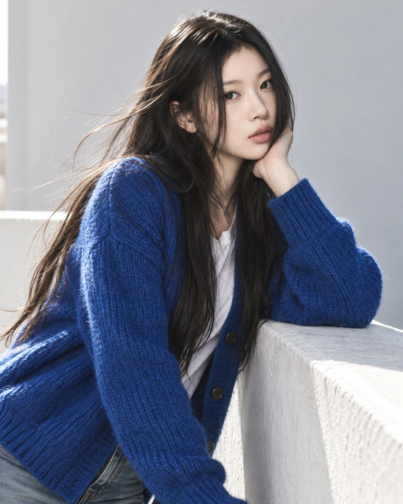
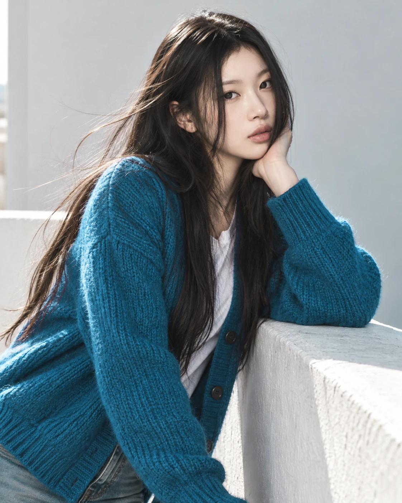

# Building a Free Photoshop Alternative, Part 7: Connecting Color Selection to Existing Code with AI

[All ten parts](README.md) · [Repository](../../README.md)

English edition · October 18, 2026 · Source excerpts pinned to their original revisions.

Hue adjustments and RGB–HSL conversions already existed. Connecting a picked color to an editable range was still application work. Photoshot’s Hue/Saturation combines range calculations, a picker and saved settings with an existing adjustment engine through code written with AI.



*Actual Photoshot workspace. The example portrait is AI-generated; the editing interface and output are from Photoshot.*

## 1. Color conversions alone do not make an interactive tool

Having HSL math and letting someone pick the blue in a photograph are different stages. Range boundaries, screen input and saved settings had to connect to existing conversions and masks. We used AI to help write and revise the code between those parts.

The existing engine already had RGB/HSL conversion functions and a shared path for masks and layer opacity. We added stored color bands and connected them to a tool that picks a color from the image.

The initial session also records a lookup of Konva’s HSL.ts, but that does not establish that Photoshot copied its range-selection code. The excerpts here are Photoshot’s own implementation published on GitHub. Extending that engine is distinct from installing an external filter.

## 2. Why 359° and 1° are neighbors

Ordinary subtraction makes 359° and 1° look 358° apart. On a hue wheel, they are neighbors around red. The modulo expression folds their difference into −180° to 180° before taking its magnitude, producing a distance of 2°.

That distance becomes a weight rather than an on/off decision. The weight is 1 inside the central range, decreases across the feather region, and reaches 0 outside. Hue, saturation, and lightness adjustments all use that weight.

Distance on a color wheel is established knowledge. The implementation task is to connect that distance to a shared weight for the adjustment amounts. Integration code written with AI turns an isolated formula into an editable setting.

[src/adjustments.ts · v0.16.0 · lines 603–610](https://github.com/Abraham721/photoshot/blob/v0.16.0/src/adjustments.ts#L603-L610)

```ts
if (!v.colorize)
  for (const band of a.bands ?? []) {
    const d = Math.abs(((h * 360 - band.center + 540) % 360) - 180),
      w = clamp(1 - (d - band.width / 2) / band.feather);
    hue += band.hue * w;
    sat += band.saturation * w;
    light += band.lightness * w;
  }
```

## 3. Reading width and feather numerically

The photo example selects blue with a center of 240°, width 30°, and feather 30°. Pixels within 15° of the center receive full strength. At 30° the weight is one half, and at 45° or farther it is zero. A width of 30° does not mean 30° on each side.

The eyedropper calculates the selected pixel’s hue and changes the center of the nearest color band. Nearly gray pixels are rejected because they do not provide a useful hue. The tool turns a click into settings that remain editable.

[src/tone-tools.ts · v0.16.0 · lines 45–48](https://github.com/Abraham721/photoshot/blob/v0.16.0/src/tone-tools.ts#L45-L48)

```ts
const bands = structuredClone(a.bands ?? makeAdjustment('hsl').bands!);
const i = Math.round(hue / 60) % 6;
bands[i].center = hue;
return { ...a, bands };
```

## 4. Versioning saturation and lightness

Revision 2 changed the multiplier for positive saturation. For example, +50 uses 1÷(1−0.5), or 2, in this path rather than 1.5. The resulting saturation is clamped to its allowed range.

Lightness also follows a revised path: the code adjusts each RGB component before converting back to HSL, instead of only changing HSL L directly. Older projects retain their earlier calculation. Adding a slider with AI was one task; improving the calculation while keeping saved projects consistent was another.

[src/adjustments.ts · v0.16.0 · lines 619–626](https://github.com/Abraham721/photoshot/blob/v0.16.0/src/adjustments.ts#L619-L626)

```ts
const ns = v.colorize
    ? v.colorizeSaturation / 100
    : clamp(
        inputS *
          (a.revision === 2 && sat > 0
            ? 1 / Math.max(0.0001, 1 - sat / 100)
            : 1 + sat / 100),
      ),
```

[src/adjustments.ts · v0.16.0 · lines 614–618](https://github.com/Abraham721/photoshot/blob/v0.16.0/src/adjustments.ts#L614-L618)

```ts
if (a.revision === 2) {
  const lit = (x: number) =>
    light < 0 ? x * (1 + light / 100) : x + ((1 - x) * light) / 100;
  [inputH, inputS, inputL] = hsl(lit(r), lit(g), lit(b), scratch);
}
```

## 5. A color range is not an object selection

The saved example applies Hue −25 and Saturation +15 to the blue band while leaving global hue, saturation, and lightness at zero. It is a separate demonstration on an AI-generated portrait, not a numerical Photoshop parity test.

Combining scattered capabilities does not only mean installing several external packages. Connecting new selection code to existing conversion functions and masks is the same kind of work. AI helped implement the shared document and settings that make these parts operate together.

A blue background may change along with a blue shirt. To target the shirt alone, combine the range adjustment with a layer mask. Next, Color Balance moves from hue ranges to shadows, midtones, and highlights.

## Image comparison



*Before: AI-generated example portrait.*



*After: actual Photoshot output. Settings and verification limits are described in the article above.*

## Implementation and references

- [Photoshot / tone-tools.ts](https://github.com/Abraham721/photoshot/blob/v0.16.0/src/tone-tools.ts)

---

[← Part 6](06-vibrance.md)
[Part 8 →](08-color-balance.md)
