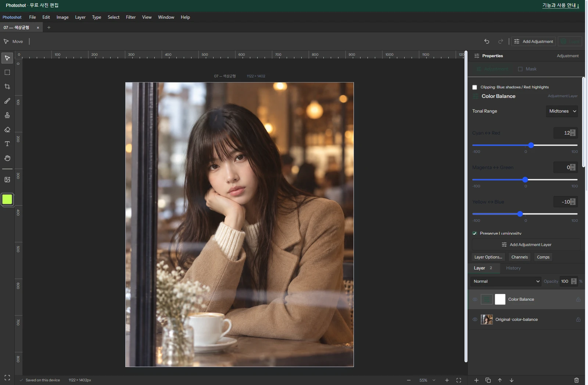

# Building a Free Photoshop Alternative, Part 8: Connecting Known Color Balance Behavior with AI

[All ten parts](README.md) · [Repository](../../README.md)

English edition · October 18, 2026 · Source excerpts pinned to their original revisions.

Adjusting color by tonal region was already possible in existing editors. Our task was to understand that behavior and implement it in an accumulated adjustment engine. Color Balance combines GIMP’s documented controls, reusable Photoshot code and calculations written and revised with AI.



*Actual Photoshot workspace. The example portrait is AI-generated; the editing interface and output are from Photoshot.*

## 1. A known design and a reusable engine

GIMP’s documentation supplied a reference for the controls. Photoshot already had input, storage and compositing code, so new work could concentrate on tonal calculations and option wiring. AI helped with that implementation and its later revisions.

The September 18 session records opening GIMP’s Color Balance documentation. It helped identify the three tonal ranges and the luminosity-preservation option. Consulting that document does not mean importing GIMP’s calculation code.

Photoshot stores R, G, and B settings for each range and processes them through its shared adjustment layer. The excerpts below come from our public v0.16.0 source. The earlier formula remains in the same file, making the change visible.

## 2. The first version blended three weights

The initial calculation obtained l from the average of the largest and smallest RGB components. Its weights were (1−l)² for shadows, l² for highlights, and 2l(1−l) for midtones. They sum to 1; at l=0.5 they are 0.25, 0.5, and 0.25.

Midtones were therefore an overlapping influence, not a hard interval. The code mixed the three settings using those weights and added the result to each channel. That is an understandable first version, but it is not the formula used by every later path.

The initial calculation connected without replacing the document structure. The shared engine handled stored values and compositing while Color Balance concentrated on color changes. Extending code with these separate responsibilities reduces repeated implementation work.

[src/adjustments.ts · v0.16.0 · lines 650–663](https://github.com/Abraham721/photoshot/blob/v0.16.0/src/adjustments.ts#L650-L663)

```ts
if (t === 'balance' && a.revision !== 2) {
  const l = (Math.max(r, g, b) + Math.min(r, g, b)) / 2,
    sh = (1 - l) ** 2,
    hi = l * l,
    mid = 2 * l * (1 - l);
  for (let c = 0; c < 3; c++)
    out[c] = clamp(
      out[c] +
        (v['shadows' + 'RGB'[c]] * sh +
          v['midtones' + 'RGB'[c]] * mid +
          v['highlights' + 'RGB'[c]] * hi) /
          100,
    );
  if (v.preserve) preserveLuma(out, luma(r, g, b));
```

## 3. The revised preservation path

With preservation enabled, revision 2 constructs black, white, and gamma values for each channel. Shadow settings affect the black reference, highlight settings the white reference, and midtone settings gamma. The code normalizes the adjusted input interval and applies gamma.

“Preserve” is the product option’s name. It should not be expanded into a guarantee that a particular luminance formula is exactly conserved for every pixel. Showing the implementation makes that distinction clear.

[src/adjustments.ts · v0.16.0 · lines 674–679](https://github.com/Abraham721/photoshot/blob/v0.16.0/src/adjustments.ts#L674-L679)

```ts
  const key = 'RGB'[c],
    black = shMax - v['shadows' + key],
    white = 255 - v['highlights' + key] + hiMin,
    gamma = 2 ** ((v['midtones' + key] - midCenter) / 100);
  out[c] = clamp((out[c] * 255 - black) / Math.max(1, white - black)) ** (1 / gamma);
}
```

## 4. Sequential response tables when preservation is off

The same revision uses balance-response.ts when preservation is off. The zone loop runs from 2 down to 0: highlights, midtones, then shadows. Each step receives the previous step’s output.

This differs from adding three weighted changes in the initial version. The revision branch lets older projects keep their earlier processing while newly created adjustments select the revised path.

[src/adjustments.ts · v0.16.0 · lines 683–689](https://github.com/Abraham721/photoshot/blob/v0.16.0/src/adjustments.ts#L683-L689)

```ts
for (let zone = 2; zone >= 0; zone--)
  out[c] = sampleResponse(
    balanceResponse[zone],
    v[['shadows', 'midtones', 'highlights'][zone] + key],
    -100,
    out[c],
  );
```

## 5. The saved example and the next step

The saved photo uses midtone Red +12 and Blue −10 with preservation on. Green and the other tonal-range settings stay at zero. It is an actual Photoshot edit of an AI-generated photograph, not proof covering every combination of the three ranges.

This episode demonstrates reuse of an established feature design and shared application code, not direct transplantation of external source. AI can contribute to an alternative editor both by helping read public code and by implementing the missing calculations and options around an existing foundation.

We reused the layer’s input, storage, and compositing flow while revising the color calculation inside it. Next, Black & White keeps separate control over colors such as red and blue even after removing their visible hue.

## Image comparison


*Before: AI-generated example portrait.*


*After: actual Photoshot output. Settings and verification limits are described in the article above.*

## Implementation and references

- [GIMP / Color Balance — behavior reference](https://docs.gimp.org/3.0/en/gimp-tool-color-balance.html)
- [Photoshot / balance-response.ts](https://github.com/Abraham721/photoshot/blob/v0.16.0/src/balance-response.ts)

---

[← Part 7](07-hue-saturation.md)
[Part 9 →](09-black-white.md)
