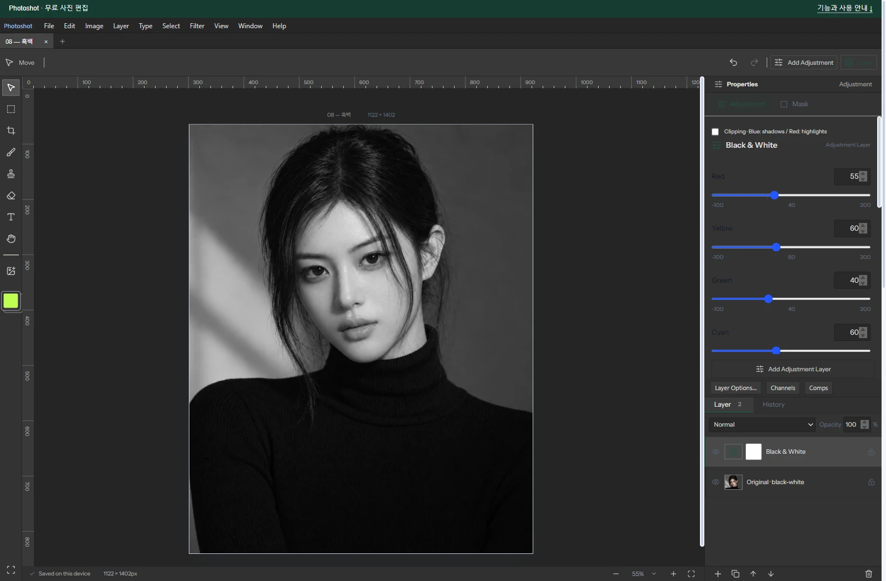
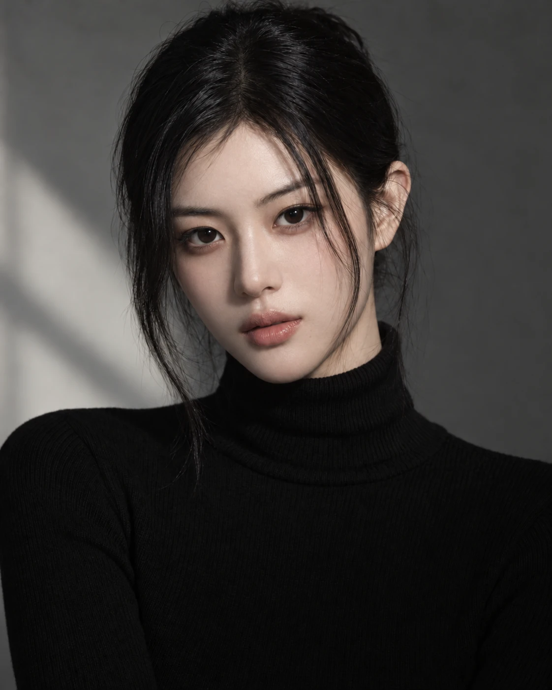
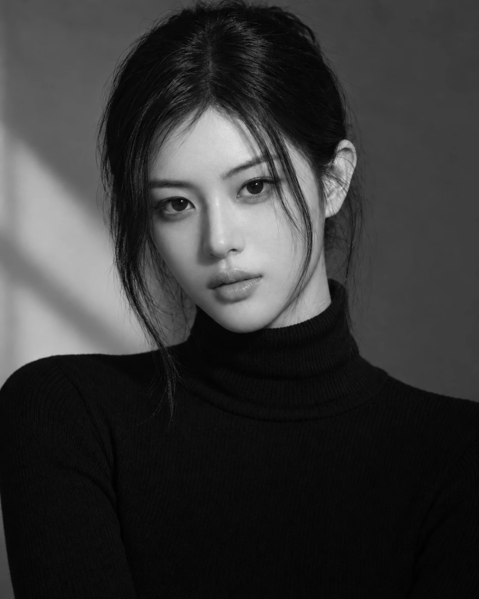

# Building a Free Photoshop Alternative, Part 9: Extending Existing Color Code into Black & White

[All ten parts](README.md) · [Repository](../../README.md)

English edition · October 18, 2026 · Source excerpts pinned to their original revisions.

Black & White did not require a new color-processing engine. We reused Photoshot’s HSL conversions and compositing, then connected color-specific gray calculations and sliders with AI. As reusable components accumulate, the scope of work needed for another editing tool becomes smaller.



*Actual Photoshot workspace. The example portrait is AI-generated; the editing interface and output are from Photoshot.*

## 1. Existing color components, a different tool

Each new feature does not need its own external repository. Conversion, storage and compositing code already connected inside the application are reusable assets too. Black & White adds calculations and controls written with AI on top of those assets.

We did not find a record of importing a particular GitHub black-and-white filter for this feature. We reused the HSL conversion and shared compositor, then wrote the per-color settings and gray calculation with AI. GitHub is where that implementation can now be inspected.

Red, yellow, green, cyan, blue, and magenta are stored as color0 through color5. Their defaults are not all identical. The important feature is editable control over how each original color becomes gray.

[src/adjustments.ts · v0.16.0 · lines 149–160](https://github.com/Abraham721/photoshot/blob/v0.16.0/src/adjustments.ts#L149-L160)

```ts
blackwhite: {
  name: '흑백',
  description: '원본의 색상별 밝기를 조절하며 흑백으로 변환합니다.',
  controls: colorNames
    .slice(0, 6)
    .map((n, i) => control('color' + i, n, -100, 300, [40, 60, 40, 60, 20, 80][i]))
    .concat(
      control('tint', '색조 입히기', 0, 1),
      control('tintHue', '색조', 0, 360, 40),
      control('tintSaturation', '색조 채도', 0, 100, 25),
    ),
},
```

## 2. Blending the two neighboring color controls

The code obtains the original hue h and multiplies it by six. The integer part i selects an interval; the fractional part f blends its two neighboring controls. A color between red and yellow responds to both sliders. Modulo arithmetic connects the final magenta interval back to red.

The resulting weight does not identify skin. It is a mixing coefficient based on the original color, so reddish skin and reddish clothing may respond in a similar direction.

Interpolation between six colors connects source color to slider settings. This AI-assisted code uses the existing HSL conversion and passes the gray result to the shared compositing path. Those boundaries show why the entire feature stack did not need rewriting.

[src/adjustments.ts · v0.16.0 · lines 692–699](https://github.com/Abraham721/photoshot/blob/v0.16.0/src/adjustments.ts#L692-L699)

```ts
if (t === 'blackwhite') {
  const [h] = hsl(r, g, b, scratch),
    pos = h * 6,
    i = Math.floor(pos) % 6,
    f = pos - Math.floor(pos),
    weight = (v['color' + i] * (1 - f) + v['color' + ((i + 1) % 6)] * f) / 100;
  const gray = clamp(Math.min(r, g, b) + (Math.max(r, g, b) - Math.min(r, g, b)) * weight);
  out.fill(gray);
```

## 3. Keeping neutral gray while changing colored pixels

Gray is computed as the RGB minimum plus the difference between maximum and minimum multiplied by weight. For an already gray pixel, that difference is zero. With tint disabled, changing the color sliders therefore leaves the original neutral gray unchanged.

Pure red directly uses color0: a setting of 55 yields normalized gray 0.55, or about 140 in 8-bit output. Pure yellow at 60 yields 153; pure blue at 5 yields about 13. These are single-color examples of the formula, not whole-photo brightness measurements or Photoshop error figures.

## 4. Tint and masks work at different stages

out.fill(gray) assigns the same gray value to all three channels. If tint is enabled, the next step adds the chosen hue and saturation. Changing the black-and-white mix is thus separate from adding a tone such as sepia.

Masks and opacity are handled by the shared compositing stage. To change only a face’s black-and-white brightness, define that area with an adjustment-layer mask rather than expecting the color calculation to recognize a face.

[src/adjustments.ts · v0.16.0 · lines 699–700](https://github.com/Abraham721/photoshot/blob/v0.16.0/src/adjustments.ts#L699-L700)

```ts
out.fill(gray);
if (v.tint) fromHsl(v.tintHue / 360, v.tintSaturation / 100, gray, out);
```

## 5. Recording all six example settings

The saved example uses Red 55, Yellow 60, Green 40, Cyan 60, Blue 5, and Magenta 80, with tint off. The original is AI-generated; the editor capture and exported result come from Photoshot.

AI’s value here was not originating the concept of grayscale conversion. It helped connect new mixing calculations and controls while retaining the responsibilities of existing code. A shared foundation makes each extension of the alternative editor more focused and manageable.

We record all six values so that the example is understandable without guessing omitted settings. This chapter documents a color-based black-and-white adjustment. The next chapter builds a color transform from a filter color and density.

## Image comparison



*Before: AI-generated example portrait.*



*After: actual Photoshot output. Settings and verification limits are described in the article above.*

## Implementation and references

- [Photoshot / adjustments.ts](https://github.com/Abraham721/photoshot/blob/v0.16.0/src/adjustments.ts)

---

[← Part 8](08-color-balance.md)
[Part 10 →](10-photo-filter.md)
