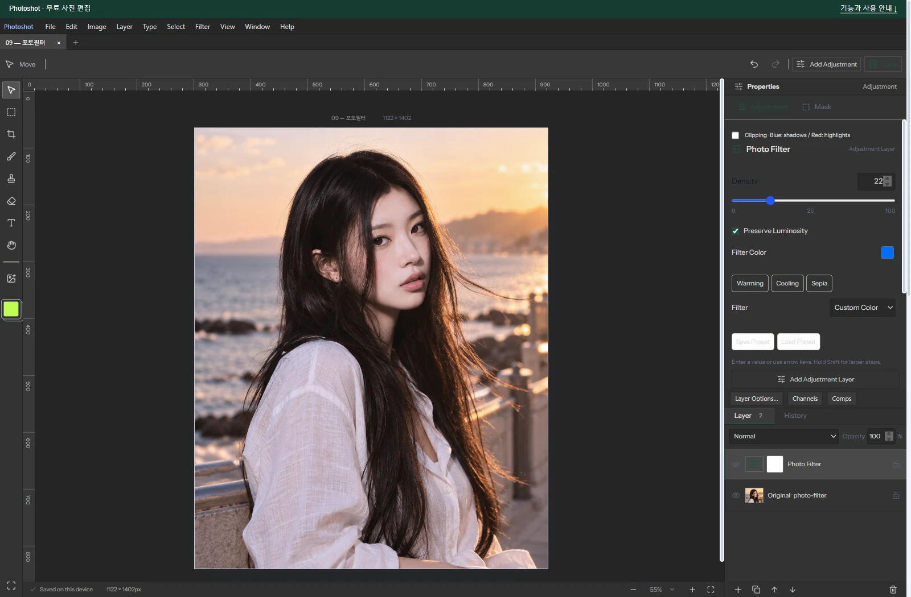
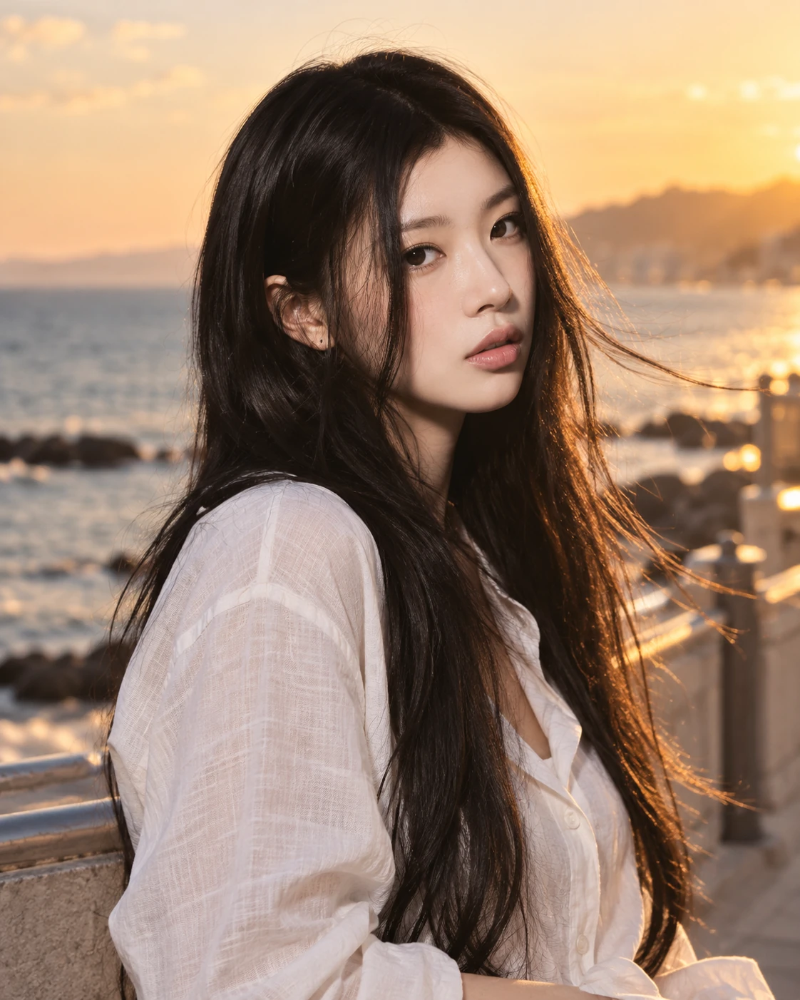
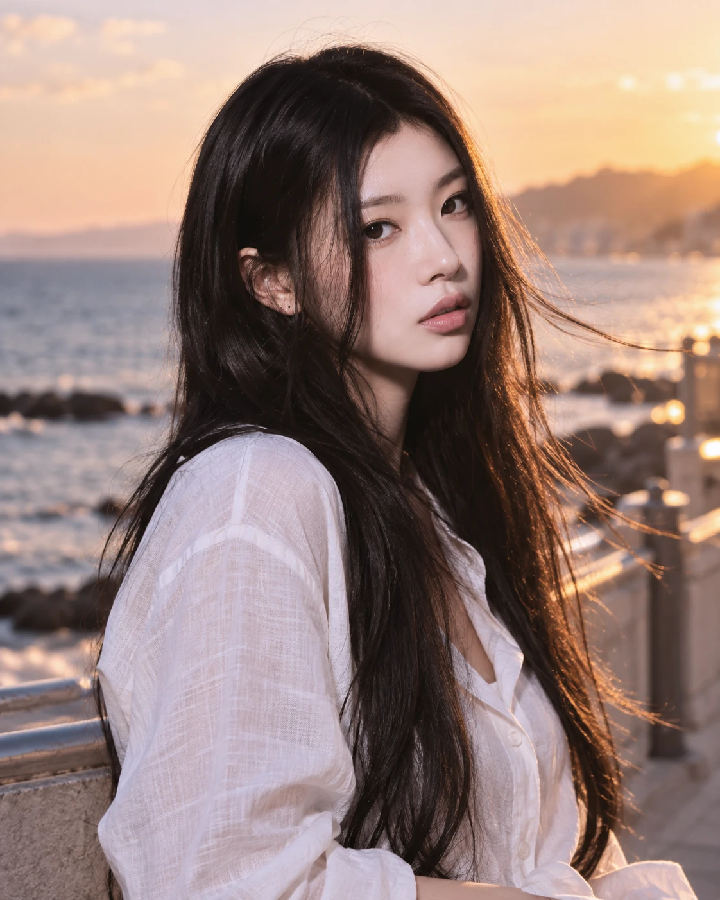

# Building a Free Photoshop Alternative, Part 10: Connecting Existing Technology into an Editor with AI

[All ten parts](README.md) · [Repository](../../README.md)

English edition · October 18, 2026 · Source excerpts pinned to their original revisions.

Color-transform mathematics, filter ideas and layer compositing already existed. The task was to connect them through one document and settings model. Revising Photo Filter with AI closes ten episodes of turning reused technology and integration work into the capabilities of an alternative editor.



*Actual Photoshot workspace. The example portrait is AI-generated; the editing interface and output are from Photoshot.*

## 1. The gap between having components and building a product

Photo Filter could use known color-transform methods and an existing adjustment engine. Density, layer opacity and masks still needed distinct responsibilities. Code written with AI connected these parts in the right order within one document.

Adobe’s documentation was used to check what filter color, density, and preservation controls mean. We did not find a record of importing this calculation from a specific external GitHub repository. The code shown here is Photoshot’s own public implementation.

We reused adjustment storage and the shared handling of masks and opacity. The transformation from filter color to pixel output was written and revised with AI. Identifying provenance requires more detail than merely linking a repository.

## 2. The initial direct color blend

The initial implementation set amount to density divided by 100, then calculated original×(1−amount)+filterColor×amount. It was a readable starting point. With preservation enabled, a separate luminance adjustment followed.

That formula remains in the public source for projects that are not revision 2. Adding a new calculation did not mean silently changing the processing of older files.

Existing settings storage and layer compositing made it possible to connect the first calculation. We could then revise that calculation while retaining the path for older documents. Reusable structure helps with revising AI-assisted code as well as adding it.

[src/adjustments.ts · v0.16.0 · lines 702–706](https://github.com/Abraham721/photoshot/blob/v0.16.0/src/adjustments.ts#L702-L706)

```ts
if (t === 'photo' && a.revision !== 2) {
  const amount = v.density / 100;
  for (let c = 0; c < 3; c++) out[c] = out[c] * (1 - amount) + colors![0][c] * amount;
  if (v.preserve) preserveLuma(out, luma(r, g, b));
}
```

## 3. Applying a matrix in linear RGB

Revision 2 first converts RGB to linear values. Filter color and density produce gains that are combined with the RGB↔XYZ matrices in the code to prepare photoMatrix. This preparation happens when compiling the adjustment, rather than being repeated for every pixel.

For each pixel, the code takes a matrix-row dot product with linear RGB, clamps the result, and converts back to sRGB. The revised implementation is a channel transform rather than the initial direct overlay of a filter color.

[src/adjustments.ts · v0.16.0 · lines 581–586](https://github.com/Abraham721/photoshot/blob/v0.16.0/src/adjustments.ts#L581-L586)

```ts
const photoMatrix =
  t === 'photo'
    ? inv.map((row) =>
        [0, 1, 2].map((c) => row.reduce((sum, x, i) => sum + x * gain[i] * xyz[i][c], 0)),
      )
    : [];
```

[src/adjustments.ts · v0.16.0 · lines 707–718](https://github.com/Abraham721/photoshot/blob/v0.16.0/src/adjustments.ts#L707-L718)

```ts
if (t === 'photo' && a.revision === 2) {
  scratch[0] = linear(r);
  scratch[1] = linear(g);
  scratch[2] = linear(b);
  for (let c = 0; c < 3; c++)
    out[c] = srgb(clamp(photoMatrix[c].reduce((sum, x, i) => sum + x * scratch[i], 0)));
  if (v.preserve) {
    scratch[0] = r;
    scratch[1] = g;
    scratch[2] = b;
    blendRGB(scratch, out, 'color', out);
  }
```

## 4. Why density is not layer opacity

Density configures the filter’s transformation itself. Layer opacity controls how the calculated result is composited with the original, alongside the mask and blend mode. The document engine passes the adjustment, layer.opacity, mask, and blend separately to adjustPixels.

Density 22% with layer opacity 50% therefore cannot generally be replaced by density 11%. Linearization, matrix processing, preservation, and compositing intervene. We kept the controls separate because they operate at different stages.

[src/document.ts · v0.16.0 · lines 284–293](https://github.com/Abraham721/photoshot/blob/v0.16.0/src/document.ts#L284-L293)

```ts
adjustPixels(
  pixels.data,
  layer.adjustment,
  layer.opacity,
  mask,
  layer.blend,
  start,
  Math.min(start + chunk, pixels.data.length),
  compiled,
);
```

## 5. The example and what these chapters connect

The saved example uses Cooling (80), filter color #006dff, density 22%, and preservation on. It is an actual editor capture and export from an AI-generated original. In the revised preservation path, the code applies color blending after filtering. This is not a guarantee of exact luminance conservation or full Adobe parity.

Across ten episodes, the argument is not that editing technology was missing until AI invented it. Libraries, public examples and known mathematics already supplied ways to implement many features. AI helped us read and connect them, write missing pieces and revise the result. Photoshot demonstrates several Photoshop-style editing capabilities assembled through that work—not complete product or output equivalence, nor a measured claim about development speed.

Parts 6–10 use different calculations but share the structure that keeps the original, stores adjustment settings, and handles masks and compositing. GitHub references, existing Photoshot code, and new AI-assisted calculations meet in that structure. Next, Channel Mixer exposes how each RGB component contributes to an output channel.

## Image comparison



*Before: AI-generated example portrait.*



*After: actual Photoshot output. Settings and verification limits are described in the article above.*

## Implementation and references

- [Adobe / Photo Filter controls — behavior reference](https://helpx.adobe.com/photoshop/using/applying-color-balance-adjustment.html)
- [Photoshot / document.ts](https://github.com/Abraham721/photoshot/blob/v0.16.0/src/document.ts)

---

[← Part 9](09-black-white.md)
